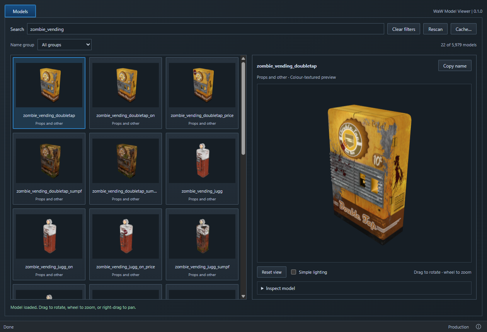

# WaW Model Viewer

**An unofficial community app. Not affiliated with Treyarch, Activision or UGX.**

Browse World at War's Modtools models and find a filename by eye. Click a thumbnail to rotate a textured preview and copy its name. Made by [phil81334](https://github.com/phil81334). Built with JavaScript, Rust, Vite, Tauri and Three.js.



## Use

1. Install the WaW Modtools in your game folder.
2. Download `waw-model-viewer.exe` from [Releases](https://github.com/phil81334/waw-model-viewer/releases/latest).
3. Put it beside `CoDWaW.exe` and open it.

Search or choose a name group, then click a thumbnail. Drag to rotate, wheel to zoom, or right-drag to pan. **Copy name** copies the filename. Groups use filename prefixes.

**Inspect model** offers LODs, bones with hover names, a checkbox for all bone names, and a mesh outline. Simple lighting is off by default.

This is a basic colour-textured viewer. No advanced game materials, animation or exporting. Models with missing files or unusable previews are hidden. Game files are never changed.

Thumbnails load as you browse and are cached in AppData. **Cache…** shows the folder and lets you clear it. **Rescan** refreshes the catalogue and retries hidden previews.

## Run from source

1. Install [Node.js LTS](https://nodejs.org/) and the [Tauri Windows prerequisites](https://v2.tauri.app/start/prerequisites/#windows): Rust and Microsoft C++ Build Tools.
2. Download and extract this repository, or clone it. Open the folder in VS Code.
3. In **Terminal → New Terminal**, run:

   ```powershell
   npm install
   $env:WAW_ROOT = 'D:\Your game folder\Call of Duty World at War'
   npm run dev
   ```

For the VS Code **NPM Scripts** play button, create `.local/game-path.txt` containing just your game folder path. Then click **dev**. The packaged app always uses its own folder.

| Command | What it does |
| --- | --- |
| `npm run dev` | Opens the desktop app for development. |
| `npm run dev:web` | Shows the UI in a browser. Cannot read game models. |
| `npm run build` | Creates `release/waw-model-viewer.exe`. |
| `npm run build:web` | Builds the UI files only. No EXE. |

The first Rust build takes longer. Windows needs [WebView2](https://developer.microsoft.com/microsoft-edge/webview2/), normally already installed. No Python needed.

[Credits](ATTRIBUTION.md) · [GPL-3.0 licence](LICENCE)
